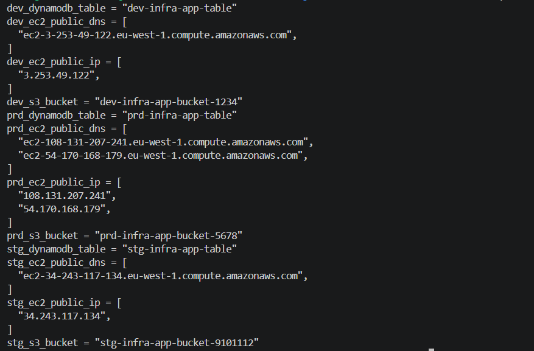
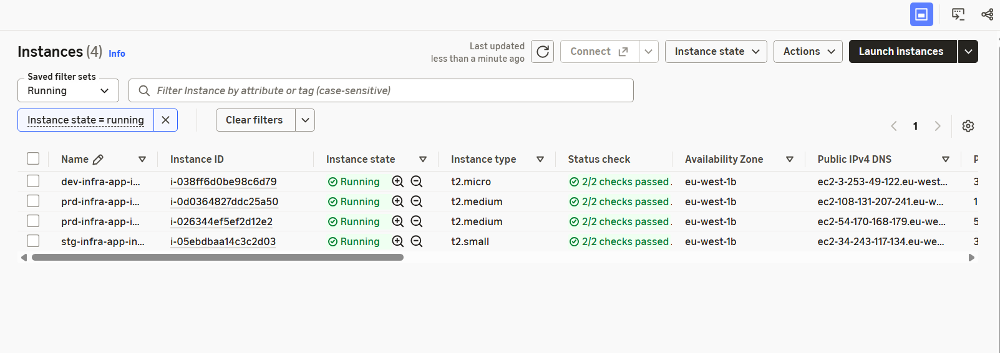
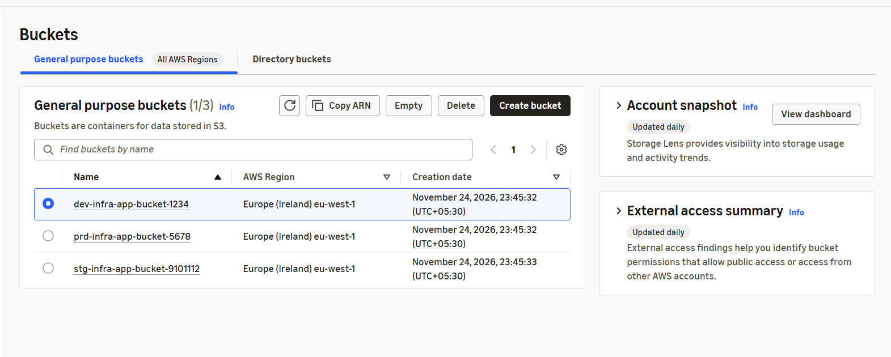
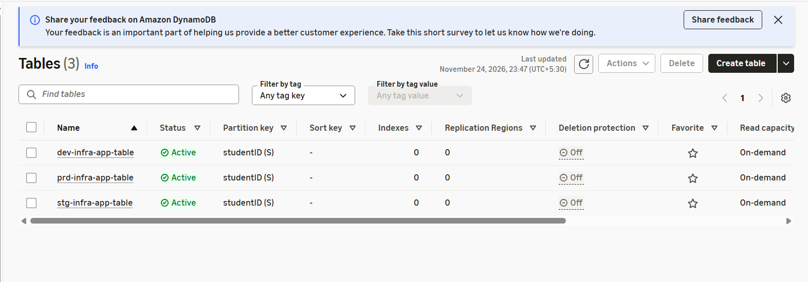

# 🚀 Terraform Multi-Environment AWS Infrastructure

This project demonstrates a professional, modular Infrastructure as Code (IaC) approach using Terraform. It provisions and manages AWS resources across three distinct environments—**Development (dev)**, **Staging (stg)**, and **Production (prd)**—from a single codebase.

## 📐 Architecture Overview

The infrastructure is deployed using a reusable child module (`infra-app`) that is instantiated three times in the root `main.tf`. Different variables are passed to each instance to ensure environment isolation and correct resource sizing.


## ✨ Key Features

*   **DRY Principle:** Modular design using a single child module for all three environments.
*   **Dynamic AMI Lookup:** Uses `data "aws_ami"` to automatically fetch the latest Amazon Linux (for dev/stg) and Ubuntu (for prd) images. No hardcoded AMI IDs.
*   **Environment-Specific Sizing:** 
    *   **Dev:** 1x `t2.micro`
    *   **Stg:** 1x `t2.small`
    *   **Prd:** 2x `t2.medium` with larger root EBS volumes.
*   **Comprehensive Outputs:** Exposes Public IPs, Public DNS, S3 Bucket names, and DynamoDB Table names to the terminal after deployment.
*   **Security Best Practices:** Includes `.gitignore` to prevent private keys and state files from being committed.

## 📂 Project Structure

```text
terraform-infra/
├── infra-app/               # Reusable Child Module
│   ├── ami.tf               # Data sources for dynamic AMIs
│   ├── dynamodb.tf          # DynamoDB table resource
│   ├── ec2_instance.tf      # EC2, Key Pair, and Security Group
│   ├── outputs.tf           # Module-level outputs
│   ├── s3.tf                # S3 bucket resource
│   └── variables.tf         # Module-level variables
├── main.tf                  # Root module (calls child module 3 times)
├── outputs.tf               # Root-level outputs
├── providers.tf             # AWS Provider configuration
├── versions.tf              # Terraform and Provider versions
└── README.md
```

## 🛠️ Prerequisites

* **Terraform** installed (`v1.0+`)
* **AWS CLI** configured with appropriate credentials (`aws configure`)
* **SSH Key Pair** generated locally (`terra-key-pair` and `terra-key-pair.pub` in the root directory)

---

## 🚀 Deployment Instructions

1. **Clone the repository:**
   ```bash
   git clone <your-repo-url>
   cd terraform-infra
   ```

2. **Initialize Terraform:**
   ```bash
   terraform init
   ```

3. **Review the execution plan:**
   ```bash
   terraform plan
   ```

4. **Apply the infrastructure:**
   ```bash
   terraform apply --auto-approve
   ```

5. **View the outputs:**
   ```bash
   terraform output
   ```

---

## 📸 Deployment Proof

### 1. Terraform Outputs
The `terraform output` command displays the dynamically generated IPs, DNS names, and resource identifiers for all environments.



### 2. AWS EC2 Console
Notice the instance types: `1x t2.micro` (dev), `1x t2.small` (stg), and `2x t2.medium` (prd) proving the conditional logic works.



### 3. AWS S3 Console
Globally unique bucket names generated per environment.



### 4. AWS DynamoDB Console
On-demand billing mode configured via Terraform with environment-specific naming.



---

## 🧹 Cleanup

To destroy all created resources and avoid AWS charges:

```bash
terraform destroy --auto-approve
```

# 

## 🧠 Key Takeaways & Learnings

Through building this project, I solidified my understanding of:
*   **Terraform Modules:** How to design reusable child modules and pass environment-specific variables.
*   **Dynamic Data Sources:** Utilizing `data "aws_ami"` to avoid hardcoding region-specific IDs.
*   **Splat Expressions:** Using `[*]` to handle resources created with `count` and outputting them as lists.
*   **AWS Core Services:** Provisioning and tagging EC2, S3, and DynamoDB resources securely.

## 👨‍💻 Author

**Rohan Jarkal**
*   GitHub: [@jarkalrohan-bit](https://github.com/jarkalrohan-bit)
<!-- *   LinkedIn: [Your Name](https://linkedin.com/in/yourprofile) -->

---
*If you found this project helpful or interesting, feel free to star ⭐ the repository!*